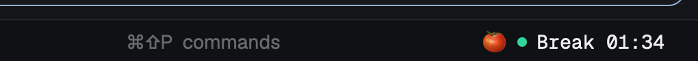

# Pomodoro for Herdr

A floating Pomodoro timer mod for the [Herdr app](https://herdr.dev). A
countdown sits inside a gradient progress ring. It cycles through focus
rounds, short breaks and long breaks, and tells you with a sound and a
notification when each phase ends.


With the optional [status bar 🍅](#status-bar--optional), the time left also
shows at the bottom right of the window:



## Features

- A focus/short break/long break cycle, with a long break after every 4 focus
  rounds.
- A progress ring that empties clockwise, with a different colour for each phase.
- In-window settings for each phase's length and how many rounds come before
  a long break.
- A daily 🍅 count of finished focus rounds.
- A window you can drag anywhere. It remembers its position and comes back
  after a restart.
- Time keeps counting when the window is closed, and it survives a Herdr
  restart.
- An optional 🍅 for the status bar that shows the time left and opens the
  window when clicked.

The mod doesn't use the network, doesn't run programs and only reads Herdr's
own shared state.

## Install

You need the Herdr app. The mod was built and checked with `herdr-app` 0.1.16.

**With an agent:** ask the coding agent you use in Herdr to add
`https://github.com/dariuszparys/herdr-pomodoro`. Herdr's `AGENTS.md` tells it
how to install shared mods.

**By hand:**

1. Clone the repository and copy the mod into your Herdr folder:

   ```sh
   git clone https://github.com/dariuszparys/herdr-pomodoro
   cp -R herdr-pomodoro/mods/pomodoro ~/.config/herdr-app/mods/
   ```

   If you already have a mod named `pomodoro`, copy this one under another
   name instead.

2. Add the shortcut to the `"global"` section of
   `~/.config/herdr-app/keys.json`:

   ```json
   "cmd-alt-p": "mod.open:pomodoro"
   ```

   Pick another key if you already use ⌘⌥P.

3. Check the mod, then open it:

   ```sh
   herdr-app check ~/.config/herdr-app/mods/pomodoro
   herdr-app do mod.open --name pomodoro
   ```

## Use

Press **⌘⌥P** to open or close the window. Herdr's command palette can't list
mods, so use the shortcut or `herdr-app do mod.open --name pomodoro`.

| Control | Key | What it does |
|---|---|---|
| Start / Pause / Resume | Space | Runs or pauses the current phase |
| ↺ | R | Resets the current phase to its full length |
| ⏭ | S | Skips to the next phase without counting a round |
| ✕ | Esc | Closes the window; the timer keeps running |
| Focus / Short break / Long break | | Switches to that phase, stopped |
| ⚙ | | Opens the settings |

Click the window first so the keys reach it.

When a phase ends, the next one is ready, but it doesn't start until you press
Start. If the window is closed when a phase ends, the sound and notification
come when you next open it.

## Settings

Click ⚙ in the window. Changes save straight away and stay after a restart.

| Setting | Default | Range |
|---|---|---|
| Focus | 25 min | 1–120 |
| Short break | 5 min | 1–30 |
| Long break | 15 min | 1–60 |
| Long break every | 4 rounds | 2–8 |

A phase that is running or paused keeps its length. Your change applies from
the next phase.

## Status bar 🍅 (optional)


The `pomodoro-status` mod puts a 🍅 at the right end of the status bar. Click it
to open or close the timer window.

| Timer | The 🍅 shows |
|---|---|
| Not started | 🍅 |
| Running | 🍅 with a pulsing dot and the time left, e.g. `Focus 18:42` |
| Paused | `Focus 22:45 · paused` |
| Finished while the window was closed | `time's up`: click to open the window and get the alert |

Herdr's own layouts are read-only, so you add the 🍅 to your own copy of a
layout. These steps use the default `main` layout:

1. Copy the mod:

   ```sh
   cp -R herdr-pomodoro/mods/pomodoro-status ~/.config/herdr-app/mods/
   ```

2. Make your own copy of the layout. This also switches to it:

   ```sh
   herdr-app do layout.clone '{"name":"main","as":"my-main"}'
   ```

3. In `~/.config/herdr-app/layouts/my-main.json`, find the block with
   `"id": "status"` and replace it with this row. It keeps Herdr's own status
   bar and adds the 🍅 beside it:

   ```json
   {
     "id": "status-row",
     "type": "row",
     "size": { "px": 28 },
     "resizable": false,
     "children": [
       { "id": "status", "type": "block", "content": { "mod": "workspace-status" } },
       { "id": "pomodoro-status", "type": "block", "size": { "px": 240 }, "content": { "mod": "pomodoro-status" } }
     ]
   }
   ```

4. Save. The window updates at once. If nothing changes, look for a
   `layout.error` file in `~/.config/herdr-app`.

Your copy of the layout won't get Herdr's future changes to `main`. The status
bar itself is still Herdr's mod and does get them. To go back, switch layouts
with ⌘⇧L or the command palette.

## Uninstall

Delete `~/.config/herdr-app/mods/pomodoro` and remove the `cmd-alt-p` line
from `keys.json`. If you added the status bar 🍅, also delete
`~/.config/herdr-app/mods/pomodoro-status` and your copy of the layout
(`layouts/my-main.json`), or put its original `status` block back.

## Build it yourself

[RECIPE.md](RECIPE.md) describes the mod in enough detail for an agent to
rebuild it from scratch, which is how mods are shared on herdr.dev.

## License

[MIT](LICENSE)
