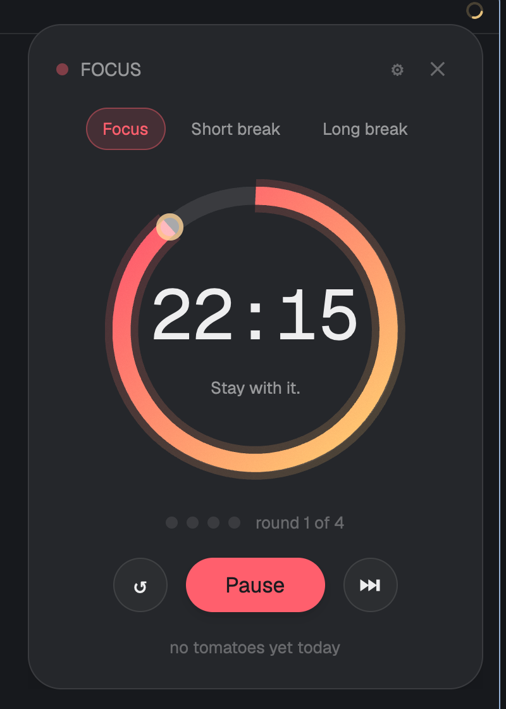

# Pomodoro

A floating Pomodoro timer window for Herdr. A countdown sits inside a thick
gradient progress ring that empties clockwise as time passes. Buttons switch
between Focus, Short break and Long break, and a row of dots counts the rounds
before a long break. When a phase ends it plays a sound, shows a notification
and moves to the next phase. A gear opens a settings view where you set the
durations. The window is drag-anywhere and reopens where you left it.

## What you see

One card, 300 px wide, sized by its content. Padding 18 px, 14 px gap between
sections, centred items. It uses the theme's `popover` background, a 1 px
`border`, 22 px corners and a large shadow. The window uses `frame: "none"`, so
the mod draws its own card.

Phase colours (gradients run at 135°):

| Phase | Label | From | To |
|---|---|---|---|
| focus | Focus | `#ff5f6d` | `#ffc371` |
| short | Short break | `#2fd69a` | `#5ee7df` |
| long | Long break | `#7f7fd5` | `#86a8e7` |

Timer view, top to bottom:

1. **Header row**, full width, items spread apart. On the left: an 8 px round
   dot (phase `from` colour while running, otherwise theme `dim`) and the
   phase label in capitals (12 px, weight 600, `muted`). On the right: two 22 px
   round icon buttons in `dim`, ⚙ (tooltip "Settings") and ✕ (tooltip
   "Close (Esc)"). Both get a `hover` background and turn `foreground` on hover.
2. **Phase buttons**: three pills, 6 px apart, 11 px text, padding 10×4. The
   active one is weight 600 in its phase `from` colour, with a background of
   that colour at alpha `26` and a 1 px border at alpha `66`. The others are
   `muted` with a transparent border.
3. **Ring**: 208×208 px. The circle's centre is at 104, its radius is 88 and
   the stroke is 12 px.
   - Track: a full circle in theme `border`.
   - Glow: the progress arc again, 22 px wide, in the phase gradient at 18%
     opacity.
   - Progress: the arc from 12 o'clock clockwise, covering *time left / phase
     length*, in the phase gradient.
   - Knob: an 18 px white circle with a 3 px border in the phase `to` colour,
     centred on the arc's end.
   - Centre: the time as `MM:SS` (46 px, weight 700, Geist Mono,
     `foreground`). Under it, 11 px `muted` text: "ready" when the phase hasn't
     started, "paused" when paused, and while running a line for the phase
     that changes every 10 minutes:
     - Focus: "One thing at a time.", "Deep work, shallow inbox.", "Ship the
       next small step.", "Stay with it."
     - Short break: "Stand up, stretch.", "Look out of a window.", "Refill
       your water.", "Breathe."
     - Long break: "Take a real walk.", "Step away from the screen.", "Make a
       tea.", "You earned this."
4. **Rounds**: one 8 px dot per round before a long break (default 4), 6 px
   apart. Finished focus rounds are `#ff5f6d`, the rest `border`. After them,
   "round N of M" (11 px, `dim`).
5. **Controls**, 12 px apart:
   - ↺: a 36 px round button with a `raised` background, 1 px `border` and
     tooltip "Reset (R)".
   - The main button: a 36 px tall pill, padding 26 px, phase `from`
     background, `#1b1b1f` text at 14 px weight 600, medium shadow. It reads
     Start, Pause or Resume.
   - ⏭: like ↺, tooltip "Skip (S)".
6. **Footer** (11 px, `dim`): "no tomatoes yet today", or one 🍅 per focus
   round finished today followed by "today". After 8 it shows 8 tomatoes and
   "×N".

Settings view (after ⚙). The header reads "SETTINGS" with an `accent` dot,
and the gear becomes ← (tooltip "Back"). Below it:

- A `surface` card with a 1 px `border`, 14 px corners and 12 px padding,
  holding four rows. Each row has a colour dot (the phase `from` colour, or
  `accent` for rounds) and a 13 px label on the left. On the right: a 26 px −
  button, the value (18 px, weight 700, Geist Mono) with its unit under it
  (10 px, `dim`), and a 26 px + button.

  | Row | Default | Range | Step |
  |---|---|---|---|
  | Focus | 25 min | 1–120 | 5 |
  | Short break | 5 min | 1–30 | 1 |
  | Long break | 15 min | 1–60 | 5 |
  | Long break every | 4 rounds | 2–8 | 1 |

- One centred 11 px `dim` line. It reads "Saved automatically.", or "The
  current phase keeps its length; changes apply from the next one." when the
  current phase is running or paused.
- Two pills: Defaults (styled like ↺) and Done (styled like the main button).

## How it behaves

- **Start / Pause / Resume** run and pause the current phase. Pausing keeps
  the time left.
- **Reset (↺, R)** puts the current phase back to its full length, stopped.
- **Skip (⏭, S)** moves to the next phase without counting a round.
- **Phase buttons** switch to that phase at its full length, stopped.
- **Order**: after Focus comes a Short break, except after the Nth focus round
  (N = "Long break every"), when a Long break follows instead. After a Long
  break the round count goes back to 0. A finished Focus phase adds a round and
  a 🍅. A skipped one adds neither.
- **When a phase ends** it plays the `done` sound and shows a notification
  (level `success`):
  - After Focus: "🍅 Focus round done (N today)"
  - After a break: "Short break is over" or "Long break is over"
  - The body names the next phase and its length, e.g. "Time for a break: short
    break, 5 min. Press Start when ready."

  The next phase is ready but doesn't start until you press Start.
- **While running**, the header dot pulses (opacity 0.3 → 1, 1.4 s) and the
  knob pulses (0.55 → 1, 1.6 s). The time updates once a second.
- **Keyboard**: click the card to give it the keyboard. Then Space starts or
  pauses, R resets, S skips and Esc closes the window. In the settings view,
  Esc goes back to the timer and the other keys do nothing.
- **Settings**: − and + change a value and save it at once. With a step of 5,
  − from 5 goes to 1 and + from 1 goes to 5. Defaults restores all four values.
  If the current phase hasn't started, a change to its own length applies
  straight away. A phase that is running or paused keeps its length.
- **Closing** the window doesn't stop the timer. Reopen it with ⌘⌥P (the
  included `keys.json`) or `herdr-app do mod.open --name pomodoro`. The window
  remembers where it was dropped and comes back after a restart until closed.
- The 🍅 count resets at local midnight.

## Built from

- `mods/pomodoro/mod.json`:
  `{"place": "none", "title": "Pomodoro", "overlay": {"kind": "window", "key": "pomodoro", "keep": true, "frame": "none"}}`.
  It docks nowhere. `mod.open {name: "pomodoro"}` opens and closes it as a
  kept, remembered window.
- `mods/pomodoro/main.js`: one `View`.
  - **gpui-kit**: `div`, `PathBuilder` and `Background`. The ring is three
    `window.paint_path(...)` layers, each absolutely positioned at 208×208
    inside a `relative` box: `PathBuilder.stroke(w)` with `move_to` and
    `arc_to`, painted with `Background.linear_gradient(135, from, to)` (and
    `.opacity(0.18)` for the glow).
  - **gpui-base**: `v_flex`, `h_flex`.
  - **herdr**: `theme`, `shared`, `setShared`, `props`, `closeOverlay`,
    `notify`, `playSound("done")`, `nextCommand`, `checking`.
  - **Animation**: `.loop("opacity", ...)` for both pulses, so no animation
    timer is needed.
  - **Timer state** is in `shared("pomodoro")`:
    `{phase, running, endsAt, remaining, total, round, day, done}`. Time left
    is `endsAt - now` while running, otherwise `remaining`. `total` is the
    phase's length when it started, so the ring stays right if settings change
    mid-phase.
  - **Settings** are in `shared("pomodoro.config")`:
    `{focus, short, long, rounds}`, clamped to the ranges above when read.
  - `cx.timer.every(1000)` redraws only while running, and finishes the phase
    when the time left reaches 0.
  - A `nextCommand()` loop handles `focus` (focus the card) and `toggle`,
    `reset`, `skip`.
  - Every button stops `on_mouse_down("left")` propagation so it doesn't drag
    the window. The card itself calls `focus()` on press.
- `keys.json`: `"global": {"cmd-alt-p": "mod.open:pomodoro"}`.
- No programs, no network, no files outside Herdr's shared state.

## Watch out

- An arc that is the full circle can't be drawn with one `arc_to`, because the
  start and end points are the same. Draw two half arcs instead. For partial
  arcs, set `large_arc` when progress is over 0.5, and set `sweep: true` for
  clockwise.
- The path coordinates are px inside the paint layer. Give each layer an
  explicit `w`/`h` and `absolute().top(0).left(0)`, or it lays out at size 0.
- Mods can't add entries to Herdr's command palette (its list is fixed and
  hides `mod.open`). Use the key binding or a button in another mod.
- A phase only ends while a copy of the mod is open. If the window was closed
  when time ran out, the sound and notification come when it next opens.
- Keep `init()` side effects behind `if (checking()) return;`.
- `nextCommand()` accepts `toggle`, `reset` and `skip`, but the included
  `keys.json` doesn't bind them, and binding them is untested.
- Optional extra, not included: a 🍅 in the status bar that shows the time
  left and opens the window. Clone `workspace-status`, read
  `shared("pomodoro")`, redraw every second only while `running`, and point a
  cloned layout's status block at the clone.

## Done when

- `herdr-app check mods/pomodoro` passes.
- ⌘⌥P (or `herdr-app do mod.open --name pomodoro`) opens the card showing
  `25:00`, "ready", a full coral-to-amber ring and "round 1 of 4". The same key
  closes it.
- Start counts down once a second. The ring shortens clockwise from 12 o'clock
  and the knob follows its end. Pause shows "paused" and Resume carries on from
  the same time.
- Closing and reopening the window mid-countdown shows the right time left.
- With Focus set to 1 minute in settings, the phase ends after a minute: the
  sound plays, the notification appears, one round dot and one 🍅 fill in, and
  the card shows Short break at `05:00`, stopped.
- After the 4th focus round, a Long break follows, and after it the round dots
  clear.
- Settings: − / + stay within each range, Defaults restores 25/5/15/4, and the
  values survive a restart.
